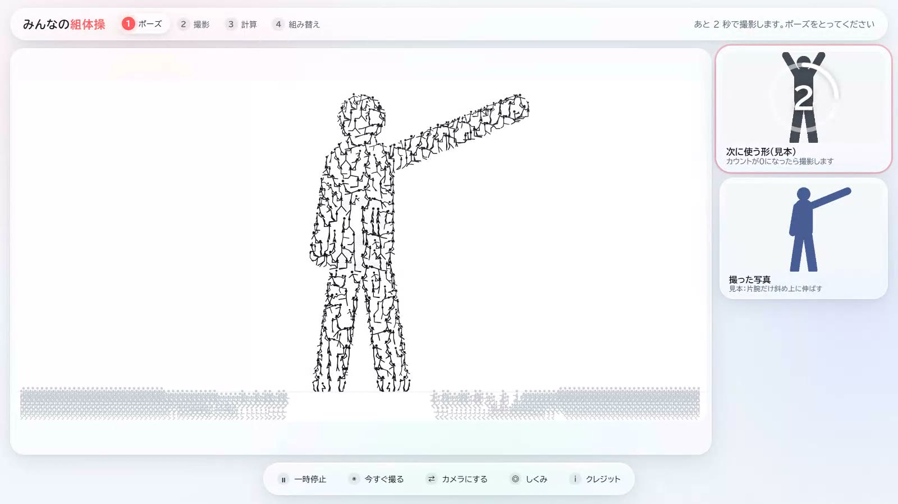

# みんなの組体操

カメラで取り込んだ人の形を集めて、積んで、動かすブラウザ作品。

[作品を見る](https://eisuke29.github.io/portfolio/work7.html) · [ポートフォリオ](https://eisuke29.github.io/portfolio/)



## 体験

写真を撮るようにポーズを取り、自分の形を取り込んで組体操を作ります。カメラがなくても見本モードで体験できます。WP実習の任意課題として個人制作し、Claude Opus 5.5との対話を活用しました。

## ローカルで動かす

このリポジトリのフォルダで次を実行し、http://localhost:8000/ を開きます。

```sh
python -m http.server 8000
```

PCのChrome等を使用します。カメラを使う場合はlocalhostまたはHTTPSで開き、使用を許可してください。画面内の遊び方動画から操作を確認できます。カメラなしの見本モードは確認済み、実機のカメラ認識は未確認です。

## 構成

`web/play/kumitaiso/` にHTML・CSS・JavaScript、TensorFlow.jsと学習済みモデルを収録しています。切り抜き・姿勢認識・手の操作・積み上げ・モーション再生を分けて実装しています。

## データの出典

- [CMU Graphics Lab Motion Capture Database](http://mocap.cs.cmu.edu/)：実動作を横から見た関節角度へ変換して利用。データはNSF EIA-0196217の支援で収録。
- [ACCAD Motion Capture / The Ohio State University](https://accad.osu.edu/research/motion-lab/mocap-system-and-data)：[CC BY 3.0](https://creativecommons.org/licenses/by/3.0/)。動作データを本作品用に変換。
- TensorFlow.js・MediaPipe・MoveNet：Apache License 2.0。`licenses/` と各ファイルの著作権表示を参照。


## 制作者・権利

木下瑛介 / Eisuke Kinoshita（[Eisuke29](https://github.com/Eisuke29)）。共同制作・外部素材については上記の説明を参照してください。自作のコード・映像・デザインについて、別途記載のない限り無断での再配布は許諾していません。外部ライブラリ・モデル・フォント等にはそれぞれのライセンスが適用されます。
